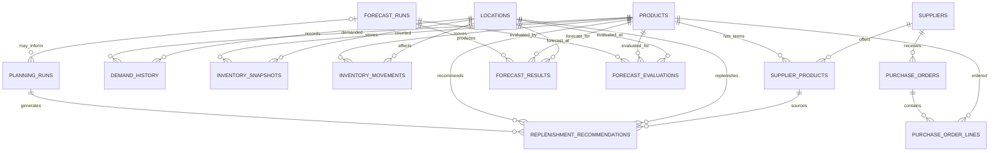

# Database ERD and Entity Relationships

**Project:** AI Demand Forecasting and Inventory Optimization  
**Document:** Database ERD and Entity Relationships  
**Version:** 1.3 — Cancellation and integrity corrections  
**Database target:** SQLite  
**Status:** Logical schema for final cross-document review; do not implement SQLite until the ERD and data dictionary pass the acceptance checklist  
**Currency:** BDT, stored as integer poisha (100 poisha = ৳1)  
**Data approach:** Reproducible synthetic data, with optional public-data comparison

---

## 1. Purpose

This document defines the proposed relational database architecture for the AI Demand Forecasting and Inventory Optimization project. It supports reproducible demand analysis, forecasting, forecast evaluation, inventory tracking, supplier sourcing, purchase-order tracking, replenishment optimization, and Power BI reporting.

The baseline contains exactly 14 tables:

1. `products`
2. `locations`
3. `suppliers`
4. `supplier_products`
5. `demand_history`
6. `inventory_snapshots`
7. `inventory_movements`
8. `purchase_orders`
9. `purchase_order_lines`
10. `forecast_runs`
11. `forecast_results`
12. `forecast_evaluations`
13. `planning_runs`
14. `replenishment_recommendations`

Dataset-generation provenance is stored outside this baseline in `data/processed/dataset_metadata.json`.

## 2. Design principles and change log

### 2.1 Design principles

- Use stable integer primary keys and explicit foreign keys.
- Use ISO-formatted dates (`YYYY-MM-DD`) and UTC ISO 8601 timestamps.
- Store quantities as integer base units unless a metric explicitly needs fractional values; `forecast_qty` and forecast-error metrics use `REAL`.
- Store every monetary value as integer poisha, not floating-point taka.
- Separate underlying demand from fulfilled sales and estimated lost demand.
- Preserve historical business records. Corrections, cancellations, and deactivations must be represented through statuses, audit events, or new effective-dated records rather than routine physical deletion.
- Use effective-dated supplier terms so historical purchase assumptions remain reproducible.
- Make synthetic datasets reproducible using a recorded generator version, random seed, and configuration.
- Do not create the physical SQLite schema until both design documents pass the final cross-document checklist.

### 2.2 Version 1.2 consolidated changes

- Align the ERD and data dictionary on the same table and column definitions.
- Standardize lifecycle statuses as lowercase values.
- Add `sales_revenue` to the ERD definition of `demand_history`.
- Include `on_order_qty` in `inventory_snapshots`, because the approved inventory-position formula uses it.
- Add supplier and location master attributes that were previously missing from the data dictionary.
- Use `planning_date` consistently for `planning_runs`.
- Remove redundant `line_status` from `purchase_order_lines`.
- Define effective-dated uniqueness and non-overlapping validity periods for `supplier_products`.
- Define evaluation and recommendation composite uniqueness keys.
- Specify restrictive foreign-key actions and the no-routine-deletion policy.
- Remove resolved decisions from the unresolved-decision list.

### 2.3 Version 1.3 integrity corrections

- Add `cancelled_qty` to purchase-order lines so partially received orders can explicitly account for quantities cancelled.
- Define purchase-order quantity reconciliation and eligible outstanding on-order quantity.
- Specify movement-type sign rules for inventory deltas.
- Align `location_type` and WAPE constraint wording with the data dictionary.
- Require Python validation of finite numeric values, including forecast quantities and metrics.

## 3. Scope and entity grains

| Table | Grain |
|---|---|
| `products` | One row per product |
| `locations` | One row per inventory location |
| `suppliers` | One row per supplier |
| `supplier_products` | One row per supplier-product effective period |
| `demand_history` | One row per product, location, and demand date |
| `inventory_snapshots` | One row per product, location, and snapshot timestamp |
| `inventory_movements` | One row per inventory movement event |
| `purchase_orders` | One row per purchase-order header |
| `purchase_order_lines` | One row per product line in a purchase order |
| `forecast_runs` | One row per forecasting execution |
| `forecast_results` | One row per forecast run, product, location, and target date |
| `forecast_evaluations` | One row per forecast run, product, location, evaluation period, and horizon |
| `planning_runs` | One row per planning execution/scenario |
| `replenishment_recommendations` | One row per planning run, product, location, and supplier-product option |

## 4. Entity relationship diagram

The diagram shows logical relationships. SQLite foreign keys must be implemented with the restrictive actions in Section 7. Mermaid cardinality does not replace the explicit column-level constraints in the data dictionary.

## 5. Table definitions

### 5.1 `products`

**Purpose:** Product master data.  
**Grain:** One row per product.

| Column | Type | Required | Key / constraint | Meaning |
|---|---|---:|---|---|
| `product_id` | INTEGER | Yes | PK | Internal product identifier |
| `sku` | TEXT | Yes | UNIQUE, non-empty | Stable stock-keeping unit |
| `product_name` | TEXT | Yes | Non-empty | Product name |
| `category` | TEXT | Yes | Non-empty | Product category |
| `unit_cost` | INTEGER | Yes | CHECK >= 0 | Reference unit cost in poisha |
| `selling_price` | INTEGER | Yes | CHECK >= 0 | Reference selling price in poisha |
| `unit_of_measure` | TEXT | Yes | Non-empty | Base unit, e.g. piece, pack, kilogram |
| `is_active` | INTEGER | Yes | CHECK IN (0, 1) | Whether the product is currently offered |

A product is deactivated with `is_active = 0`; historical records must not be deleted when a product is discontinued.

### 5.2 `locations`

**Purpose:** Warehouses, stores, distribution centers, or other inventory locations.  
**Grain:** One row per location.

| Column | Type | Required | Key / constraint | Meaning |
|---|---|---:|---|---|
| `location_id` | INTEGER | Yes | PK | Internal location identifier |
| `location_code` | TEXT | Yes | UNIQUE, non-empty | Stable location code |
| `location_name` | TEXT | Yes | Non-empty | Location name |
| `location_type` | TEXT | No | Controlled vocabulary in application validation | Type such as warehouse, store, or distribution center |
| `region` | TEXT | Yes | Non-empty | Geographic or operational region |
| `is_active` | INTEGER | Yes | CHECK IN (0, 1) | Whether the location is currently active |

Locations are deactivated rather than physically deleted.

### 5.3 `suppliers`

**Purpose:** Supplier master data.  
**Grain:** One row per supplier.

| Column | Type | Required | Key / constraint | Meaning |
|---|---|---:|---|---|
| `supplier_id` | INTEGER | Yes | PK | Internal supplier identifier |
| `supplier_code` | TEXT | Yes | UNIQUE, non-empty | Stable supplier code |
| `supplier_name` | TEXT | Yes | Non-empty | Supplier name |
| `contact_reference` | TEXT | No | — | Optional non-sensitive contact reference |
| `default_lead_time_days` | INTEGER | No | CHECK >= 0 | Default lead time in calendar days |
| `is_active` | INTEGER | Yes | CHECK IN (0, 1) | Whether the supplier is currently active |

Detailed supplier-product lead times are maintained in `supplier_products`; the supplier-level lead time is only a default.

### 5.4 `supplier_products`

**Purpose:** Effective-dated supplier-specific purchasing terms for products.  
**Grain:** One row per supplier, product, and effective period.

| Column | Type | Required | Key / constraint | Meaning |
|---|---|---:|---|---|
| `supplier_product_id` | INTEGER | Yes | PK | Unique terms-version identifier |
| `supplier_id` | INTEGER | Yes | FK → `suppliers.supplier_id` | Supplier |
| `product_id` | INTEGER | Yes | FK → `products.product_id` | Supplied product |
| `unit_purchase_cost` | INTEGER | Yes | CHECK >= 0 | Unit purchase cost in poisha |
| `lead_time_days` | INTEGER | Yes | CHECK >= 0 | Expected lead time in calendar days |
| `min_order_qty` | INTEGER | Yes | CHECK > 0 | Minimum order quantity in base units |
| `order_multiple` | INTEGER | Yes | CHECK > 0 | Order quantity increment in base units |
| `is_preferred` | INTEGER | Yes | CHECK IN (0, 1) | Whether this option is preferred |
| `effective_from` | TEXT | Yes | ISO date | Inclusive start date of terms |
| `effective_to` | TEXT | No | ISO date; >= `effective_from` when present | Inclusive end date; NULL means open-ended |

**Integrity rules:**
- Unique key: (`supplier_id`, `product_id`, `effective_from`).
- Effective periods for the same supplier-product pair must not overlap. Application validation/tests enforce this rule.
- Historical terms must not be overwritten to represent a later change; insert a new effective-dated row.
- Planning uses the terms valid on the planning run's `planning_date`.
- `effective_to` is inclusive. Adjacent periods must therefore be defined without overlapping dates.

### 5.5 `demand_history`

**Purpose:** Underlying customer demand, fulfilled sales, and stockout effects.  
**Grain:** One row per product, location, and demand date.

| Column | Type | Required | Key / constraint | Meaning |
|---|---|---:|---|---|
| `demand_id` | INTEGER | Yes | PK | Internal demand-record identifier |
| `product_id` | INTEGER | Yes | FK → `products.product_id` | Product demanded |
| `location_id` | INTEGER | Yes | FK → `locations.location_id` | Location where demand occurred |
| `demand_date` | TEXT | Yes | ISO date | Demand date |
| `units_demanded` | INTEGER | Yes | CHECK >= 0 | Underlying customer demand in base units |
| `units_sold` | INTEGER | Yes | CHECK >= 0 | Fulfilled sales in base units |
| `stockout_flag` | INTEGER | Yes | CHECK IN (0, 1) | Whether stockout affected the observation |
| `estimated_lost_demand` | INTEGER | Yes | CHECK >= 0 | Estimated demand not fulfilled due to availability |
| `sales_revenue` | INTEGER | Yes | CHECK >= 0 | Revenue from fulfilled sales in poisha |

**Integrity rules:**
- Unique key: (`product_id`, `location_id`, `demand_date`).
- `units_sold` must not exceed `units_demanded` unless a documented business rule explicitly permits substitutions/adjustments.
- `estimated_lost_demand` is an estimate and must not be silently added to fulfilled sales.
- A confirmed zero-demand date is represented by a row with `units_demanded = 0`.
- A missing or unknown date is not a zero-demand date. Missing dates must be identified and resolved or explicitly flagged before forecasting.
- Synthetic generation must produce a complete daily series for each product-location combination in scope.

### 5.6 `inventory_snapshots`

**Purpose:** Inventory balances at specific points in time.  
**Grain:** One row per product, location, and snapshot timestamp.

| Column | Type | Required | Key / constraint | Meaning |
|---|---|---:|---|---|
| `snapshot_id` | INTEGER | Yes | PK | Internal snapshot identifier |
| `product_id` | INTEGER | Yes | FK → `products.product_id` | Product counted |
| `location_id` | INTEGER | Yes | FK → `locations.location_id` | Location counted |
| `snapshot_time` | TEXT | Yes | ISO 8601 UTC timestamp | Snapshot timestamp |
| `on_hand_qty` | INTEGER | Yes | CHECK >= 0 | Physical quantity on hand |
| `reserved_qty` | INTEGER | Yes | CHECK >= 0 and <= `on_hand_qty` | Quantity reserved/allocated within on-hand stock |
| `on_order_qty` | INTEGER | Yes | CHECK >= 0 | Eligible outstanding purchase-order quantity |
| `backorder_qty` | INTEGER | Yes | CHECK >= 0 | Unfulfilled demand carried forward |

Unique key: (`product_id`, `location_id`, `snapshot_time`).

**Inventory position formula:**

`inventory_position = on_hand_qty - reserved_qty + on_order_qty - backorder_qty`

Reserved stock is included in on-hand stock and is deducted once. `on_order_qty` includes only outstanding quantities on eligible `ordered` or `partially_received` purchase-order lines; cancelled, draft, approved-but-not-ordered, fully received, and otherwise ineligible quantities are excluded. Backorders are deducted because they represent unfulfilled demand carried forward. Inventory position may be negative.

### 5.7 `inventory_movements`

**Purpose:** Inventory-affecting events.  
**Grain:** One row per inventory movement event.

| Column | Type | Required | Key / constraint | Meaning |
|---|---|---:|---|---|
| `movement_id` | INTEGER | Yes | PK | Internal movement identifier |
| `product_id` | INTEGER | Yes | FK → `products.product_id` | Product affected |
| `location_id` | INTEGER | Yes | FK → `locations.location_id` | Location affected |
| `movement_time` | TEXT | Yes | ISO 8601 UTC timestamp | Time of movement |
| `movement_type` | TEXT | Yes | Controlled vocabulary | Inventory event type |
| `quantity_delta` | INTEGER | Yes | CHECK <> 0 | Signed physical-stock change |
| `reference_type` | TEXT | No | — | Source transaction type |
| `reference_id` | TEXT | No | — | Source transaction identifier |
| `notes` | TEXT | No | — | Optional explanatory note |

The initial `movement_type` vocabulary is `receipt`, `sale`, `customer_return`, `supplier_return`, `adjustment_increase`, `adjustment_decrease`, `transfer_in`, `transfer_out`, and `damage_or_writeoff`. The application must validate values and signs: `receipt`, `customer_return`, `adjustment_increase`, and `transfer_in` require positive `quantity_delta`; `sale`, `supplier_return`, `adjustment_decrease`, `transfer_out`, and `damage_or_writeoff` require negative `quantity_delta`. Validate this pairing in Python and tests. These mappings are the baseline synthetic-model assumption; exceptional business cases require an explicit rule revision. A polymorphic `reference_type`/`reference_id` pair is not a conventional foreign key; validate it in application logic or replace it with a more specific relational design if stronger database enforcement is required.

### 5.8 `purchase_orders`

**Purpose:** Purchase-order headers.  
**Grain:** One row per purchase order.

| Column | Type | Required | Key / constraint | Meaning |
|---|---|---:|---|---|
| `purchase_order_id` | INTEGER | Yes | PK | Internal purchase-order identifier |
| `supplier_id` | INTEGER | Yes | FK → `suppliers.supplier_id` | Supplier receiving the order |
| `order_date` | TEXT | Yes | ISO date | Date order was placed/recorded |
| `expected_delivery_date` | TEXT | No | ISO date | Expected delivery date, if known |
| `actual_delivery_date` | TEXT | No | ISO date | Actual completion/delivery date, if known |
| `status` | TEXT | Yes | Controlled vocabulary | Current order lifecycle status |
| `external_reference` | TEXT | No | UNIQUE when non-NULL | External purchase-order reference |

Status values and transitions:
- `draft` → `approved` or `cancelled`
- `approved` → `ordered` or `cancelled`
- `ordered` → `partially_received`, `received`, or `cancelled`
- `partially_received` → `received` or `cancelled`
- `received` and `cancelled` are terminal

On cancellation, set each line’s `cancelled_qty` to the quantity no longer expected so `received_qty + cancelled_qty = ordered_qty`; preserve receipt history. A partially received order may be cancelled only after this reconciliation. `received` means every ordered unit has been received and `cancelled_qty` is zero. Expected delivery date must not precede order date unless a documented exception is recorded. Draft and cancelled orders are retained for auditability and excluded from eligible on-order inventory.

### 5.9 `purchase_order_lines`

**Purpose:** Products, quantities, and costs belonging to purchase orders.  
**Grain:** One row per product line within a purchase order.

| Column | Type | Required | Key / constraint | Meaning |
|---|---|---:|---|---|
| `purchase_order_line_id` | INTEGER | Yes | PK | Internal line identifier |
| `purchase_order_id` | INTEGER | Yes | FK → `purchase_orders.purchase_order_id` | Parent order |
| `product_id` | INTEGER | Yes | FK → `products.product_id` | Product ordered |
| `ordered_qty` | INTEGER | Yes | CHECK > 0 | Quantity ordered in base units |
| `received_qty` | INTEGER | Yes | DEFAULT 0; CHECK >= 0 and <= `ordered_qty` | Cumulative quantity received |
| `cancelled_qty` | INTEGER | Yes | DEFAULT 0; CHECK >= 0 and `received_qty` + `cancelled_qty` <= `ordered_qty` | Cumulative quantity explicitly cancelled and no longer expected |
| `unit_cost` | INTEGER | Yes | CHECK >= 0 | Agreed unit cost in poisha |

Unique key: (`purchase_order_id`, `product_id`). Duplicate product lines in the same order are not allowed in the baseline. Line-level expected delivery dates are deferred; the baseline uses the header's expected date. Receipt history must be preserved when order quantities or statuses change. No `line_status` column is used because receipt state is derived from quantities and parent order status.

Rules:
- `ordered_qty` must be positive; `received_qty` and `cancelled_qty` must be non-negative, and their sum must not exceed `ordered_qty`.
- `cancelled_qty` explicitly records quantities no longer expected and makes partial-receipt cancellation reconcilable.
- For a `cancelled` purchase order, every line must satisfy `received_qty + cancelled_qty = ordered_qty`. For a `received` purchase order, every line must satisfy `received_qty = ordered_qty` and `cancelled_qty = 0`.
- For `draft`, `approved`, `ordered`, and `partially_received` orders, `cancelled_qty` must remain zero until cancellation is recorded.
- Eligible outstanding quantity for an `ordered` or `partially_received` order is `ordered_qty - received_qty - cancelled_qty`; only this quantity contributes to `on_order_qty`.
- Validate cross-row/header status and quantity reconciliation in Python and tests; the simple column-level `CHECK` cannot enforce all parent-status rules.

### 5.10 `forecast_runs`

**Purpose:** Metadata and configuration for each demand-forecasting execution.  
**Grain:** One row per forecast execution.

| Column | Type | Required | Key / constraint | Meaning |
|---|---|---:|---|---|
| `forecast_run_id` | INTEGER | Yes | PK | Internal forecast-run identifier |
| `run_time` | TEXT | Yes | ISO 8601 UTC timestamp | Time execution was recorded |
| `model_name` | TEXT | Yes | Non-empty | Model identifier, e.g. `seasonal_naive` |
| `model_version` | TEXT | Yes | Non-empty | Model/code version |
| `training_start_date` | TEXT | No | ISO date | Start of training window |
| `training_end_date` | TEXT | No | ISO date | End of training window |
| `forecast_start_date` | TEXT | Yes | ISO date | First target date |
| `forecast_end_date` | TEXT | Yes | ISO date; >= start | Last target date |
| `evaluation_config` | TEXT | Yes | Valid JSON | Evaluation settings and reproducibility configuration |
| `status` | TEXT | Yes | Controlled vocabulary | Run lifecycle status |

Status values: `pending`, `running`, `completed`, `failed`. Allowed transitions: `pending` → `running` → `completed` or `failed`. A failed run cannot be changed to completed; retry with a new run. Training end date must not precede training start date when both are present. Forecast end date must not precede forecast start date. A successful run must have validated forecast results.

### 5.11 `forecast_results`

**Purpose:** Forecast values produced by a forecast run.  
**Grain:** One row per forecast run, product, location, and target date.

| Column | Type | Required | Key / constraint | Meaning |
|---|---|---:|---|---|
| `forecast_result_id` | INTEGER | Yes | PK | Internal forecast-result identifier |
| `forecast_run_id` | INTEGER | Yes | FK → `forecast_runs.forecast_run_id` | Generating run |
| `product_id` | INTEGER | Yes | FK → `products.product_id` | Forecast product |
| `location_id` | INTEGER | Yes | FK → `locations.location_id` | Forecast location |
| `target_date` | TEXT | Yes | ISO date | Date being forecast |
| `forecast_qty` | REAL | Yes | CHECK >= 0 and finite | Predicted demand in base units |

Unique key: (`forecast_run_id`, `product_id`, `location_id`, `target_date`). Forecast quantities may be fractional model outputs; downstream replenishment quantities are converted to valid integer quantities using documented rounding and supplier constraints.

### 5.12 `forecast_evaluations`

**Purpose:** Accuracy metrics for a defined evaluation scope.  
**Grain:** One row per forecast run, product, location, evaluation period, and horizon.

| Column | Type | Required | Key / constraint | Meaning |
|---|---|---:|---|---|
| `forecast_evaluation_id` | INTEGER | Yes | PK | Internal evaluation identifier |
| `forecast_run_id` | INTEGER | Yes | FK → `forecast_runs.forecast_run_id` | Evaluated forecast run |
| `product_id` | INTEGER | Yes | FK → `products.product_id` | Product scope |
| `location_id` | INTEGER | Yes | FK → `locations.location_id` | Location scope |
| `evaluation_start_date` | TEXT | Yes | ISO date | First evaluation date |
| `evaluation_end_date` | TEXT | Yes | ISO date; >= start | Last evaluation date |
| `horizon_days` | INTEGER | Yes | CHECK > 0 | Evaluation horizon |
| `mae` | REAL | Yes | CHECK >= 0 and finite | Mean absolute error |
| `rmse` | REAL | Yes | CHECK >= 0 and finite | Root mean squared error |
| `wape` | REAL | No | CHECK >= 0 when non-NULL | Weighted absolute percentage error ratio |
| `forecast_bias` | REAL | Yes | Finite | Mean forecast-minus-actual error |

Unique key: (`forecast_run_id`, `product_id`, `location_id`, `evaluation_start_date`, `evaluation_end_date`, `horizon_days`).

WAPE = `SUM(ABS(forecast - actual)) / SUM(actual)` over the evaluation scope. Store a non-negative decimal ratio, not a percentage from 0 to 100. WAPE can exceed 1. Store `NULL` when total actual demand is zero. Reports display the ratio as a percentage. Forecast bias is forecast minus actual; positive means overforecasting and negative means underforecasting. Evaluation must use the agreed actual-demand measure and avoid temporal data leakage.

### 5.13 `planning_runs`

**Purpose:** Replenishment-planning execution or scenario metadata.  
**Grain:** One row per planning execution/scenario.

| Column | Type | Required | Key / constraint | Meaning |
|---|---|---:|---|---|
| `planning_run_id` | INTEGER | Yes | PK | Internal planning-run identifier |
| `planning_date` | TEXT | Yes | ISO date | Effective date for inventory/supplier-term decisions |
| `scenario_name` | TEXT | Yes | Non-empty | Human-readable scenario name; repeated names allowed |
| `forecast_run_id` | INTEGER | No | FK → `forecast_runs.forecast_run_id` | Optional forecast used by this scenario |
| `scenario_config` | TEXT | Yes | Valid JSON | Scenario assumptions, constraints, and planning parameters |
| `status` | TEXT | Yes | Controlled vocabulary | Planning-run lifecycle status |

Status values: `pending`, `running`, `completed`, `failed`. Allowed transitions: `pending` → `running` → `completed` or `failed`. A failed run cannot become completed; retry with a new planning run. Scenario names are not unique; each execution is identified by `planning_run_id`. Supplier terms are selected as valid on `planning_date`.

### 5.14 `replenishment_recommendations`

**Purpose:** Replenishment decisions generated by a planning run.  
**Grain:** One recommendation per planning run, product, location, and supplier-product option.

| Column | Type | Required | Key / constraint | Meaning |
|---|---|---:|---|---|
| `recommendation_id` | INTEGER | Yes | PK | Internal recommendation identifier |
| `planning_run_id` | INTEGER | Yes | FK → `planning_runs.planning_run_id` | Generating planning run |
| `product_id` | INTEGER | Yes | FK → `products.product_id` | Product being considered |
| `location_id` | INTEGER | Yes | FK → `locations.location_id` | Location being replenished |
| `supplier_product_id` | INTEGER | Yes | FK → `supplier_products.supplier_product_id` | Sourcing option |
| `recommendation_date` | TEXT | Yes | ISO date | Date recommendation was generated |
| `reorder_point` | INTEGER | Yes | CHECK >= 0 | Reorder threshold in base units |
| `recommended_qty` | INTEGER | Yes | CHECK >= 0 | Proposed order quantity in base units |
| `estimated_cost` | INTEGER | Yes | CHECK >= 0 | Estimated procurement cost in poisha |
| `status` | TEXT | Yes | Controlled vocabulary | Recommendation lifecycle status |

Unique key: (`planning_run_id`, `product_id`, `location_id`, `supplier_product_id`). Multiple supplier alternatives are allowed for a product-location pair, but duplicate rows for the same supplier-product option in one planning run are not allowed.

Status values and transitions:
- `proposed` → `approved`, `rejected`, or `cancelled`
- `approved` → `ordered` or `cancelled`
- `rejected`, `ordered`, and `cancelled` are terminal

The selected supplier-product option must supply the recommended product and be valid on the planning date. Positive recommendations must respect minimum order quantities and order multiples. A zero quantity means no additional order is suggested. Estimated cost must reconcile with recommended quantity and effective supplier-specific purchase cost using documented rounding. The forecast reference, if any, is obtained through `planning_runs.forecast_run_id`; recommendations do not store a separate forecast-run foreign key.

## 6. Core relationships

- One supplier can offer many products through effective-dated `supplier_products` rows.
- One product can have multiple suppliers and multiple historical supplier-term versions.
- Demand, inventory snapshots, inventory movements, forecast results, forecast evaluations, and recommendations reference both product and location.
- Purchase orders reference a supplier; order lines reference a product and a purchase-order header.
- Forecast results and evaluations reference a forecast run.
- A planning run may reference one forecast run or no forecast run.
- Every replenishment recommendation references one planning run and one supplier-product sourcing option.

## 7. Business rules and integrity requirements

### 7.1 Historical preservation

Routine processing must not physically delete business records. Primary keys are immutable. Corrections must be represented with documented correction/audit records or new records; cancellations and deactivations use status fields. Historical supplier terms remain as effective-dated records. Published outputs must not be replaced until a new run has passed validation.

### 7.2 Foreign keys and referential actions

- Enable `PRAGMA foreign_keys = ON` for every SQLite connection and verify enforcement.
- Use `ON DELETE RESTRICT` and `ON UPDATE RESTRICT` for all foreign keys.
- Do not use cascading deletes or cascading updates.
- Routine application workflows must not physically delete business records, even if a record currently has no references.
- Parent rows must not be removed or have keys changed while referenced.

### 7.3 Currency and numeric precision

- Currency is BDT.
- Monetary values are stored as integer poisha; 100 poisha = ৳1.
- Do not store money as SQLite `REAL`.
- Convert/display in taka only at presentation boundaries.
- Quantity fields are integer base units unless explicitly documented otherwise.

### 7.4 Demand and stockout integrity

- Preserve the distinction between underlying demand, fulfilled sales, and estimated lost demand.
- Confirmed zero-demand dates must be explicit zero-valued records.
- Unknown or missing demand dates must be flagged, not silently filled with zero.
- Forecasting must reject or explicitly flag unresolved gaps.
- The synthetic generator must create a complete daily series for every product-location combination in scope.

### 7.5 Inventory calculations

Use:

`inventory_position = on_hand_qty - reserved_qty + on_order_qty - backorder_qty`

Reserved quantity is contained in on-hand quantity and is deducted exactly once. Eligible outstanding purchase-order quantity is `ordered_qty - received_qty - cancelled_qty`; this quantity contributes to `on_order_qty`. Cancelled or fully received quantities do not. Backorders are subtracted. Inventory position may be negative. Snapshot validation requires `reserved_qty <= on_hand_qty`.

### 7.6 Forecasting and evaluation

- Each forecast result references a valid forecast run.
- Forecast quantities must be non-negative and finite.
- Training/forecast/evaluation windows must be valid and avoid temporal leakage.
- Store reproducibility configuration and code/model version.
- Apply the WAPE and forecast-bias definitions in Section 5.12.
- Publish outputs only after all required validation passes.

### 7.7 Planning and recommendations

- Every recommendation references a planning run.
- Supplier-product validity is evaluated on `planning_date`.
- Replenishment quantities must satisfy supplier minimum quantities and order multiples when quantity is positive.
- Scenario names may repeat; IDs distinguish executions.
- Status transitions are validated in application logic and tests.
- A failed planning run is not overwritten or converted to completed; retries create a new run.

### 7.8 Dates, timestamps, and controlled values

- Dates: ISO `YYYY-MM-DD`.
- Timestamps: ISO 8601 UTC.
- Boolean fields: integer `0` or `1`.
- Status values and movement types use the exact lowercase vocabularies documented in Section 5.
- Application validation must reject invalid status transitions and invalid controlled values.

## 8. SQLite implementation requirements

When implementation is authorized:

1. Create the database from the approved ERD and data dictionary.
2. Use explicit primary keys, foreign keys, `NOT NULL`, `UNIQUE`, and `CHECK` constraints.
3. Enable foreign keys on every connection.
4. Add indexes for foreign-key columns and common date/status filters.
5. Store and validate JSON configuration as text using Python's JSON parser; SQLite JSON functions may be used only if available in the target environment.
6. Use transactions for multi-table writes.
7. Do not publish generated files until the pipeline completes successfully.
8. Keep `data/processed/dataset_metadata.json` outside the 14-table schema.
9. Do not implement cascading deletes.
10. Do not implement the database until the final checklist in Section 11 is passed.

## 9. Proposed indexes

Create indexes only after confirming actual query patterns. Initial candidates:

- `supplier_products(supplier_id, product_id, effective_from)`
- `demand_history(product_id, location_id, demand_date)` with a unique constraint
- `inventory_snapshots(product_id, location_id, snapshot_time)`
- `inventory_movements(product_id, location_id, movement_time)`
- `purchase_orders(supplier_id, order_date)` and `purchase_orders(status, expected_delivery_date)`
- `purchase_order_lines(purchase_order_id, product_id)` with a unique constraint
- `forecast_results(forecast_run_id, product_id, location_id, target_date)` with a unique constraint
- `forecast_evaluations(forecast_run_id, product_id, location_id, evaluation_start_date, evaluation_end_date, horizon_days)` with a unique constraint
- `planning_runs(status, planning_date)`
- `replenishment_recommendations(planning_run_id, product_id, location_id, supplier_product_id)` with a unique constraint

## 10. Validation and test plan

Before database implementation is accepted, tests must cover:

- All 14 tables and every documented column.
- Primary keys, foreign keys, unique keys, and check constraints.
- Foreign-key enforcement on each connection.
- `ON DELETE RESTRICT` and `ON UPDATE RESTRICT`; no cascade behavior.
- No routine physical deletion of historical records.
- Effective-dated supplier-product uniqueness and overlap detection.
- Inventory-position formula and `reserved_qty <= on_hand_qty`.
- Inventory movement type/sign pairings, including positive and negative movement types.
- Python finite-number validation for forecast quantities and metrics.
- Demand integrity, explicit zero-demand dates, and unresolved date-gap detection.
- Purchase-order lifecycle transitions; `received_qty`/`cancelled_qty` reconciliation; and eligible outstanding on-order quantity calculations.
- Forecast run status transitions, forecast-result uniqueness, and valid dates.
- WAPE zero-denominator behavior, evaluation uniqueness, and finite/non-negative metrics.
- Planning-run lifecycle transitions and reproducible configuration.
- Recommendation uniqueness, valid supplier-product match, status transitions, and quantity/cost calculations.
- Failure handling: invalid input fails clearly; recoverable row issues are recorded; prior historical records and published outputs remain intact.
- Synthetic data reproducibility from generator version, seed, and configuration.

## 11. Deferred scope and acceptance checklist

### 11.1 Deferred scope

The following are outside the baseline 14-table schema and must be revisited only if project requirements justify the added complexity:

- Separate audit-event table for every field change.
- Supplier delivery performance history.
- Multiple receipts per purchase-order line as separately normalized receipt records.
- Line-level expected delivery dates and split-delivery scheduling.
- Multi-currency purchasing.
- Lot/batch, expiry-date, and serial-number inventory.
- Explicit transfer-header and transfer-line entities.
- Database-level enforcement for polymorphic inventory-movement references.

These are deferred scope, not blockers for the current logical schema. Any later addition requires updating both design documents together.

### 11.2 Acceptance checklist

- [ ] The ERD and data dictionary list exactly the same 14 tables.
- [ ] Every table has the same column names, SQLite types, requiredness, keys, and business meaning in both documents.
- [ ] All primary keys, foreign keys, unique keys, and check constraints are documented.
- [ ] All monetary fields use integer poisha.
- [ ] Demand, fulfilled sales, stockouts, and estimated lost demand are distinct.
- [ ] Confirmed zero-demand dates are distinct from missing/unknown dates.
- [ ] The inventory-position formula and its inputs are consistent.
- [ ] Supplier-product effective periods and overlap rules are explicit.
- [ ] Purchase-order, forecast-run, planning-run, and recommendation statuses and transitions match.
- [ ] Forecast evaluation and recommendation uniqueness keys match.
- [ ] Foreign-key actions and historical-preservation policy match.
- [ ] Markdown headings, tables, code spans, and Mermaid syntax render correctly.
- [ ] No unresolved schema decisions remain in either document.
- [ ] Physical SQLite implementation remains blocked until this checklist is passed.

## 12. Next step

Cross-check this ERD against `docs/data_dictionary.md` field by field. Resolve any discrepancy in both documents together. Only after both documents pass the acceptance checklist should the physical SQLite schema and implementation tests be created.

**End of document**
